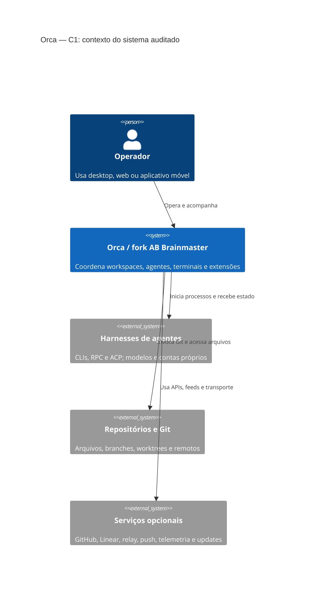
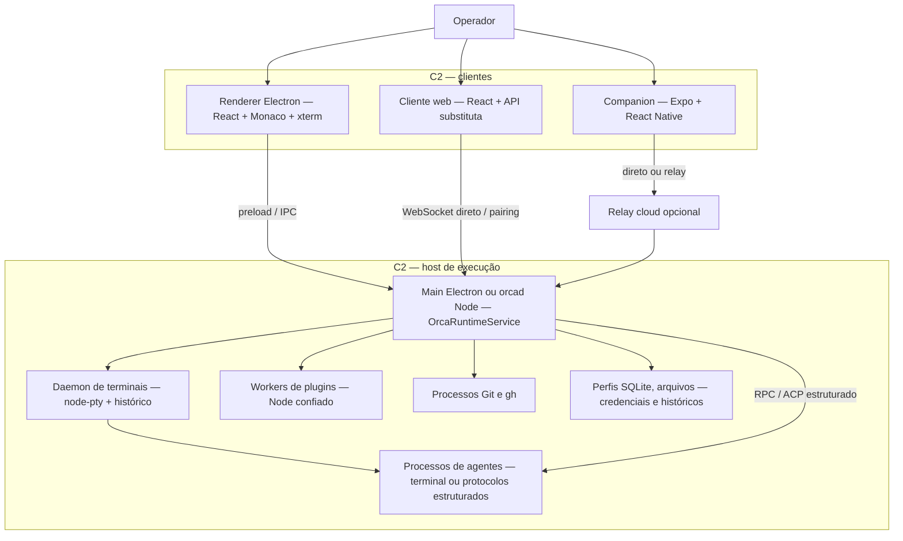
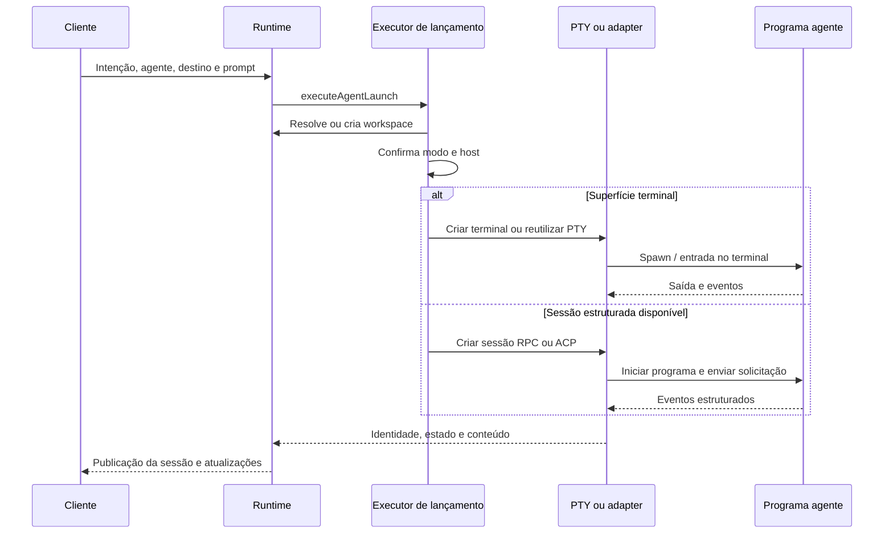
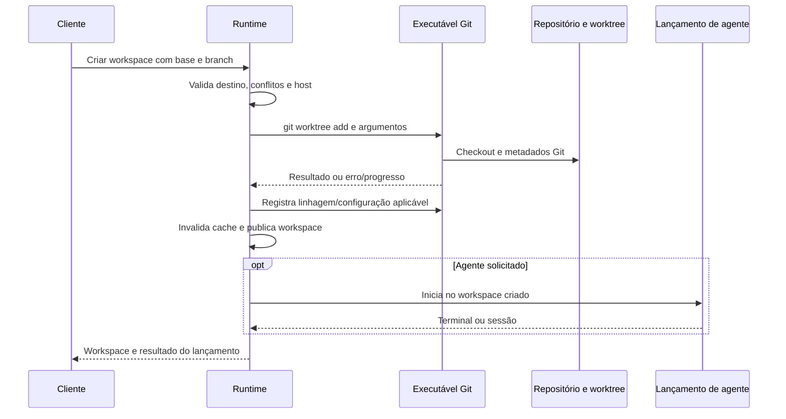
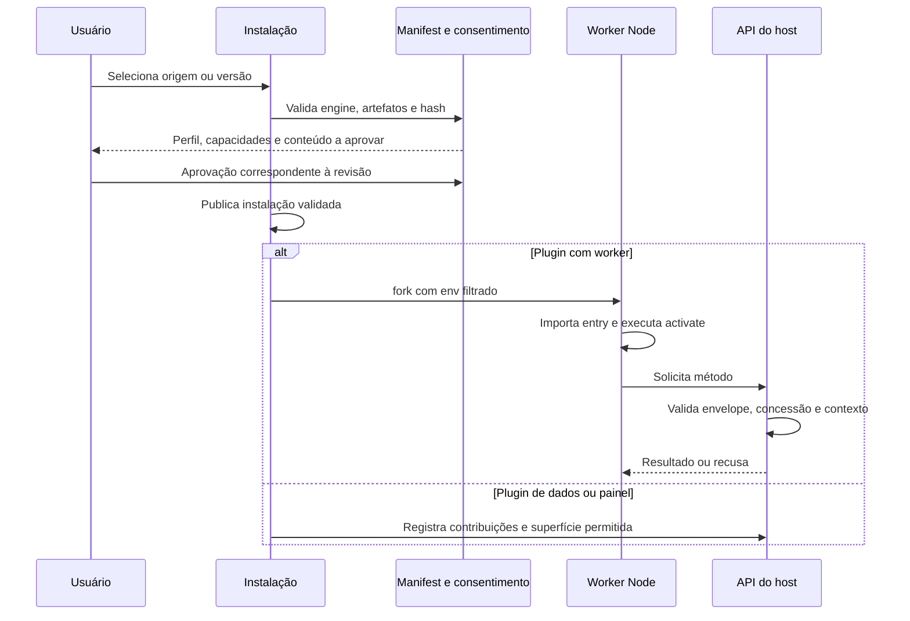

# Orca — auditoria de arquitetura e implicações para AB Brainmaster Orca

**Base imutável:** stablyai/orca, commit **d616c1b9eac49b4f4e1c73a1eb5e802c67c332bb**, datado de 2 de novembro de 2026; package.json declara **1.4.214**. Este relatório descreve o upstream nesse commit. Alterações posteriores feitas no fork precisam de verificação própria. O nome do diretório local, ab-brainmaster-orca, não é evidência de que identidade, serviços ou binários já tenham sido personalizados. [E01][E67]

**Resultado central:** Orca é uma plataforma de execução e acompanhamento de agentes de programação com desktop Electron, runtime reutilizado por servidor Node, clientes web/móvel, terminais persistentes, worktrees Git, revisão Monaco e sistema de plugins. O código confirma grande parte da arquitetura sugerida, mas corrige três associações: o terminal é **xterm.js sobre node-pty**, Git usa **executáveis CLI**, e sintaxe/diff usa **Monaco, Monarch e TextMate**, sem evidência de Ghostty como motor, libgit2 ou tree-sitter no conjunto pesquisado. O fork fornece uma base extensa para uma estação de agentes; não entrega, por simples renomeação, um produto de inferência local nem um servidor de equipe com os mesmos contratos da AB Ratoeira. [E01][E09][E10][E14][E16][E17][E51]

## Método e limites da evidência

Foram lidos AGENTS.md raiz e o adicional do daemon antes da auditoria. Foi feita leitura semântica dos caminhos decisivos de inicialização, agentes, PTY, Git, editor, CDP, RPC, storage, plugins, credenciais, telemetria e atualização. O inventário de diretórios foi mais amplo que a leitura semântica: encontrar um nome de arquivo, dependência ou texto de interface serviu para localizar código, não para certificar um recurso. Não houve execução do código upstream, instalação de dependências, build, testes, abertura do aplicativo, conexão a serviços, alteração de código ou parada de processos por esta frente. [E69][E29]

O arquivo architecture-evidence.json contém 84 registros de fonte, commit, caminho, símbolo, intervalo de linhas, SHA-256 do arquivo e URL permanente, além de 33 conclusões classificadas e comandos de busca negativa. Os links E01–E83 neste documento levam ao commit auditado. Esta é uma auditoria estática de arquitetura e fronteiras de confiança, não um pentest, medição de performance ou certificado de compatibilidade.

As classificações usadas são:

| Classe                  | O que significa                                                                                                       |
| ----------------------- | --------------------------------------------------------------------------------------------------------------------- |
| Implementado            | Há um caminho de execução identificável no código lido.                                                               |
| Padrão                  | O valor inicial ou condição de entrada foi localizado; pode ser substituído por preferências, ambiente ou plataforma. |
| Configuração            | Há uma opção ou entrada de build/runtime; sua presença não confirma que esteja ativa na instalação.                   |
| Capacidade              | O código oferece o modo, sujeito a ferramentas, credenciais, bundle e host compatíveis.                               |
| Ausência observada      | Uma busca definida não encontrou a implementação alegada; não é prova universal de inexistência.                      |
| Inferência/recomendação | Consequência arquitetural ou decisão proposta a partir da evidência; não é um recurso já entregue.                    |

## Conferência das alegações de stack

| Alegação                       | Veredito no commit                | Evidência e ressalva                                                                                                                                                                                                 |
| ------------------------------ | --------------------------------- | -------------------------------------------------------------------------------------------------------------------------------------------------------------------------------------------------------------------- |
| Electron                       | Confirmado                        | Entrada importa Electron; pacote declara Electron 43.8.4. [E01][E03]                                                                                                                                                 |
| React + TypeScript             | Confirmado                        | Renderer React e arquivos TS/TSX; React ~19.2.8 e TypeScript ^7.0.2 declarados. Versões declaradas não substituem inventário dos artefatos instalados. [E01][E05]                                                    |
| Tailwind CSS                   | Confirmado                        | Plugin @tailwindcss/vite e Tailwind ^4.3.3. [E01][E02]                                                                                                                                                               |
| node-pty                       | Confirmado                        | spawnNativeDaemonPty chama nodePty.spawn com shell, ambiente, cwd e tamanho. [E09]                                                                                                                                   |
| Ghostty como motor do terminal | Não sustentado                    | O motor de interface encontrado é xterm.js. Ghostty aparece em importação/resolução de temas e no nome do tema escuro padrão. [E01][E10][E12][E13]                                                                   |
| WebGL obrigatório              | Corrigir                          | Aceleração padrão é auto, com mecanismos de fallback e recuperação; addon WebGL é carregado sob demanda. [E10][E11][E12]                                                                                             |
| libgit2 / nodegit              | Não encontrado                    | Implementação invoca executável Git via runner; worktree add é explícito. Busca no commit em src, cloud, mobile, native, package.json e lockfile retornou zero ocorrências de libgit2/nodegit/simple-git. [E14][E15] |
| Monaco para editor/diff        | Confirmado                        | DiffViewer importa DiffEditor de @monaco-editor/react. [E16]                                                                                                                                                         |
| tree-sitter para diff/sintaxe  | Não encontrado                    | Busca no mesmo escopo retornou zero ocorrências; tokenizer lido usa Monaco/Monarch e TextMate/Oniguruma. [E01][E17][E18]                                                                                             |
| CDP                            | Confirmado                        | CdpBridge, proxy WebSocket e canais de debugger sobre WebContents. [E19][E20]                                                                                                                                        |
| IPC por sockets/tokens         | Confirmado, com camadas distintas | API de renderer por preload Electron; RPC local do CLI; protocolo separado do daemon; WS/E2EE para clientes pareados. [E04][E22]–[E28][E54]                                                                          |
| GitHub e Linear                | Confirmado como capacidade        | GitHub via gh, Linear via SDK; existência não comprova login nem permissões da conta. [E30][E31][E32]                                                                                                                |
| Somente JSON local             | Incorreto no estado atual         | Perfil gravável exige SQLite; JSON legado participa de migração/recuperação. [E33]–[E36]                                                                                                                             |
| Somente desktop                | Incorreto                         | Há servidor orcad, bundle web, aplicativo Expo/React Native e relay/push públicos. [E52][E57][E58][E78][E79]                                                                                                         |
| Ollama nativo no chat          | Não demonstrado                   | Há comando custom para receitas e adapters de harnesses externos; não foi localizado provider HTTP Ollama próprio no chat. [E51][E74]–[E77][E83]                                                                     |

A busca negativa foi feita sobre arquivos do commit pelo Git, não sobre dependências instaladas nem sobre toda a internet. “Ghostty-class” na apresentação do produto não foi usado como prova de implementação.

## C4: contexto e containers

O contexto C1 distingue o produto, o operador e dependências que mantêm autoridade própria. Serviços externos incluem tanto provedores de modelos como integrações opcionais; o usuário pode escolher caminhos locais, mas o código do desktop não torna automaticamente local o modelo executado por outro programa.

O C2 abaixo representa containers/processos; o runtime é uma camada lógica dentro do main Electron ou do host Node. Não se deve desenhar um novo microserviço para cada diretório de src/main. O catálogo de entradas de build identifica quais componentes realmente podem virar processos ou workers separados. [E03][E06][E48][E52]

O diagrama não exige relay para o cliente web ou para todo acesso remoto. O caminho direto tem implementação própria. Os clientes também não possuem necessariamente todas as capacidades do desktop: execução de browser Electron, integrações nativas e ações específicas da plataforma dependem do host/superfície. [E54][E78][E79][E80]

## Fluxo de agentes e worktrees

**Orca não é apenas um emulador de terminal com abas.** OrcaRuntimeService centraliza workspaces, layout, identidade de sessão, eventos e acesso aos serviços. executeAgentLaunch recebe a intenção, decide a superfície, resolve/cria o workspace, valida disponibilidade no host, cria terminal ou sessão estruturada e entrega o prompt. Há tratamento de cancelamento e de workspace já criado; uma recusa definitiva da superfície estruturada pode selecionar terminal com aviso. Isso é diferente de repetir cegamente o mesmo prompt após falha ambígua. [E48][E49][E50]

A superfície inicial declarada é terminal. O catálogo estruturado inclui Pi RPC, Codex, Claude e specs ACP; esses adapters resolvem e iniciam programas, descobrem modelos e trabalham com contas/históricos do harness. A existência da interface de chat nativa não significa que o Orca implementa o modelo ou a inferência. O campo global nativeChatPermissionMode inicia como full-access, mas o modo efetivo depende das regras de cada adapter, configurações e local de execução. Esse valor merece revisão explícita no fork; não equivale a afirmar que todos os CLIs ignoram confirmação. [E12][E51]

O fluxo de worktree usa Git real. performAddWorktree constrói argumentos worktree add, pode usar --no-checkout, cria branch com --no-track -b quando necessário, resolve a base e encaminha ao runner. Depois há configuração de linhagem de branch e, conforme o caso, upstream. A rotina também pode configurar push.autoSetupRemote no repositório. Portanto criar worktree pode alterar configuração compartilhada do Git além de criar uma pasta. O default refreshLocalBaseRefOnWorktreeCreate é false. [E12][E14][E15]

**Worktree não é isolamento de segurança.** É uma separação de diretórios/branches para trabalho concorrente. O PTY inicia processos com o ambiente e autoridade do host; não foi encontrado, nesse fluxo, um sandbox universal por worktree. O daemon inclui mecanismos de vida de processo, ownership e limites condicionais por plataforma, mas isso não permite prometer que cada agente fica confinado aos arquivos de sua branch. [E09][E15][E29]

Ollama merece uma separação própria. CustomAgentCommandField descreve receitas de mensagem de commit, pull request e nome de branch e mostra ollama run como exemplo. O prompt vai por argumento quando há marcador ou por stdin; source-control-local-process executa um programa local. Isso comprova uma extensão por comando para essas receitas. Não comprova chat multimodal, streaming, ferramentas ou provider Ollama HTTP implementados pelo Orca. Pi expõe get_available_models e IDs provider/model; usar modelos locais por Pi/OpenCode é uma possibilidade do harness externo que precisa ser configurada e testada à parte. [E74][E75][E76][E77][E83]

## Terminal, editor e browser

O backend de terminal fica em daemon separado. spawnNativeDaemonPty carrega node-pty e inicia o shell com dimensões, cwd e env, incluindo caminhos específicos para ConPTY no Windows e wrappers da plataforma. A interface usa addons xterm, incluindo WebGL, pesquisa, serialização e outros listados no pacote. O carregamento WebGL é adiado e seu lifecycle contempla perda de contexto e fallback; auto não é uma garantia de aceleração ativa em toda GPU. [E01][E09][E10][E11]

O daemon guarda histórico e checkpoints; TerminalSnapshot descreve ANSI, scrollback, modos, cwd, dimensões e identidade. HistoryManager e o log binário versionado permitem recompor texto/estado. Deve-se separar **processo ainda vivo no daemon**, **restauração da imagem do terminal** e **retomada lógica da conversa pelo harness**: são três mecanismos e têm condições diferentes. A persistência do scrollback não prova que um processo morto voltou a executar. [E27][E37][E38][E51][E84]

O editor/diff é Monaco, integrado por @monaco-editor/react. Tokenização pode vir de Monaco/Monarch ou TextMate com engine de expressões regulares/gramáticas; o tokenizer não é o motor de Git, nem uma prova de diff semântico por AST. Uma integração futura com análise estrutural teria de ser especificada como novo recurso. O default editorAutoSave é false; o texto promocional sobre autosave não deve substituir a configuração efetiva observada. [E01][E12][E16][E17][E18]

CDP aparece no controle de WebContents: CdpBridge agrupa ações; CdpWsProxy fornece descoberta/ponte WebSocket e se liga ao debugger. O proxy verifica Host loopback e recusa requisições com Origin. Esse controle reduz exposição a páginas web e rebinding, mas não é autenticação de um processo local por token. É uma fronteira diferente do RPC do runtime. Não foi assumido que todo fluxo de browser é um servidor Playwright independente; dependências e fixtures de testes não demonstram isso. [E19][E20][E21]

A janela principal declara sandbox:true e preload. Os webviews passam por políticas de nodeIntegration, contextIsolation, webSecurity e partição. A presença de preload com muitos métodos ainda exige revisão de validação e identidade do chamador por operação; a flag sandbox isoladamente não certifica todos os IPCs. [E04][E07][E08]

## IPC, remoto e operação sem relay

Há quatro canais que devem permanecer separados no mapa e no modelo de ameaça:

| Canal                     | Função                            | Proteção observada                                                                                                          |
| ------------------------- | --------------------------------- | --------------------------------------------------------------------------------------------------------------------------- |
| Renderer → main           | API desktop                       | contextBridge.exposeInMainWorld e handlers IPC explícitos. [E04]                                                            |
| CLI → runtime local       | Comandos de automação             | Socket Unix ou named pipe, NDJSON, token aleatório de 24 bytes convertido em hex, validação de envelope. [E22]–[E26]        |
| Host → daemon PTY         | Controle e streaming de terminais | Handshake com versão/token e papéis control/stream; arquivos e socket privados no POSIX. [E27][E28]                         |
| Cliente pareado → runtime | Web/móvel/desktop remoto          | WebSocket, identidade revogável de dispositivo, token ou prova de chave, E2EE conforme protocolo. [E54][E55][E56][E78][E82] |

O transporte Unix do runtime limita mensagens a 1 MiB, conexões a 32 e timeout ocioso a 30 s, suspenso durante despacho. Os detalhes não devem ser aplicados automaticamente ao daemon, cujo framing e canais são outros. Os metadados locais incluem o token e são gravados por writeSecureJsonFile; no POSIX há modos privados. Named pipes no Windows não têm chmod Unix, então a proteção de autenticação não pode ser descrita apenas como “arquivo 0600”. [E23][E24][E25][E26][E72]

O adicional AGENTS.md do daemon registra invariantes de propriedade do endpoint: somente o daemon que publica seu endpoint pode substituir uma entrada que provou morta; encerramento não deve apagar nome de outro daemon. Isso explica uma parte importante da complexidade: continuidade dos terminais e prevenção de corridas ao substituir processos. Não é apropriado unificar todos os arquivos socket por um limpador genérico no fork. [E29]

**Servidor próprio e LAN direta têm implementação.** startOrcad instala adapters de host Node, abre perfil, liga daemon/runtime e cria OrcaRuntimeRpcServer com WebSocket e bundle web. resolveOrcadBindHost usa 127.0.0.1 na ausência de opção; uma interface de rede precisa ser selecionada explicitamente. WebSocketTransport pode servir o cliente estático na mesma porta; o browser abre handshake com transport:direct. Esse caminho não depende do relay cloud. [E52][E53][E54][E78][E79][E80]

“Direto na LAN” ainda requer bundle web íntegro, pareamento e ferramentas no servidor. Assets HTTP não são por si uma sessão autenticada; a autorização dos comandos acontece no protocolo de cliente pareado. E2EE protege os frames implementados, mas não resolve sozinho a autenticidade do JavaScript entregue inicialmente por HTTP. Esse último é uma inferência de segurança da topologia, não um teste realizado.

Foi encontrado um texto de erro pedindo ORCA_ALLOW_INSECURE_WEB_PAIRING para HTTP remoto, mas a leitura semântica corrigiu a interpretação: web-origin-security.ts declara que esse diagnóstico foi mantido para versões antigas v1.4.225–v1.4.228 e que hosts atuais ignoram o marcador de upgrade. Não foi localizada leitura atual da variável no servidor. Portanto este relatório **não afirma um bloqueio HTTP por padrão** a partir de uma string de interface. [E81]

SSH tem execução remota e port forwarding; orcad é um host de runtime, enquanto SSH é um mecanismo de acesso/provisionamento/túnel. O relay cloud é outra opção de conectividade. O companion usa Expo/React Native e E2EE v2 com transcript, chaves direcionais e contadores. Isso comprova código criptográfico, sem substituir auditoria independente da composição ou garantir privacidade de metadados/push. [E55][E56][E57][E70][E71]

## Plugins: instalação, execução e confiança

O manifest distingue data, declarative, sandboxed-ui e trusted-worker. Temas/sintaxes não precisam receber automaticamente a mesma autoridade de um worker Node. Capabilities incluem workspace:read/write, agent:read/launch, terminal:send/read, notifications:show, storage:own, secrets:own e settings:own. Essas capacidades são contratos do host, e algumas operações dão autoridade relevante: terminal:send permite introduzir comandos em terminais locais ou SSH. [E39][E40]

A instalação valida manifest, faixa engines.orca, identidade/publisher, artefatos, árvore e hash. fingerprintPluginConsent incorpora capacidades, perfil de execução, presença de worker e identidade de conteúdo executável/declarativo. Uma atualização que passa de painel a Node worker cruza uma fronteira de confiança mesmo se a lista de capabilities não mudar. [E41][E42]

**Worker separado não é sandbox do sistema.** startPluginWorker usa child_process.fork, limpa execArgv, filtra env e cria canal IPC. O runtime do worker importa o entry do plugin como módulo Node e chama sua função de ativação. O filtro evita repassar automaticamente segredos exportados no shell, mas não elimina a autoridade de Node sobre arquivos, rede e outros processos que o usuário do host consegue acessar. “storage:own” descreve a API do Orca; não deve ser promovido a garantia de confinamento de todo Node. [E43][E44][E45]

Frames desktop usam partição/sessão com bloqueio de rede, permissões e downloads. O caminho web usa iframe/srcdoc com CSP própria. O upstream documenta limitações residuais de DNS/WebRTC para esse caso em plugin-panel-shell.ts. Isso foi registrado como risco reconhecido no código, não como exploração confirmada nesta auditoria. Uma estratégia de plugins para AB Brainmaster deve preservar a distinção de perfis e o consentimento associado à revisão, em vez de tornar todo plugin confiado por padrão. [E46][E47]

## Dados, segredos, telemetria e atualizações

O armazenamento gravável atual usa profile-state.db com driver node:sqlite. A factory retorna backend:sqlite e recusa ausência da autoridade; arquivos JSON legados não significam dual-write permanente nem um segundo backend vivo intercambiável. A abertura valida integridade/esquema antes de migrar/configurar pragmas e pode abrir versão futura em leitura. Há infraestrutura de writer/backup separada na lista de entradas. [E06][E33][E34][E35][E36]

Dados ficam em mais de um domínio: perfil e layout, repositórios/worktrees, históricos de terminal, históricos do harness, contas/credenciais e caches. Logo, copiar apenas o SQLite não demonstra um backup completo. O fork precisa mapear esses domínios antes de definir exportação, migração e retenção, especialmente quando o perfil está em uma máquina e os agentes em outra. [E35][E37][E38][E51][E52]

Credenciais usam uma abstração SecretStore. Há fallback **plaintext** quando a criptografia não está disponível em writeEncryptedCredential e em createEncryptedApiKeyFileStore; isso é explicitamente registrado no código, com publicação privada/atômica de arquivos. Linear usa essa rotina compartilhada. Orcad tem implementação própria de chave e sealing, com registro host-file e estados de proteção; não é sinônimo de keychain do desktop. É incorreto prometer “todos os tokens sempre criptografados” sem especificar ambiente e comportamento de falha. [E32][E62][E63][E64][E65][E72]

Telemetria exige uma leitura em duas etapas. O cliente PostHog só inicializa quando há feature flag habilitado, identidade de build stable/rc e write key compilada. O build lê essas variáveis e substitui ausência por null; portanto um build comunitário sem esses valores falha fechado nesse caminho. O comentário atribui a injeção ao CI oficial, mas o código em si não prova exclusividade do CI: um operador do build pode fornecer valores. [E02][E60]

Nos builds habilitados, resolveConsent mantém estado ausente como pending_banner, respeita opt-out persistido e desativa por DO_NOT_TRACK/ORCA_TELEMETRY_DISABLED ou CI. Há um detalhe de UX importante: reconhecer/dispensar o banner grava optedIn:true; isso não deve ser chamado de consentimento explícito por toggle em todos os caminhos. O transporte aponta us.i.posthog.com, usa disableGeoip:true e credentials:omit. A evidência é sobre esse transporte; não sobre toda a rede do produto. Provedores, GitHub, Linear, catálogos, updater, relay e push têm outras finalidades. [E59][E60][E61]

O updater é uma prioridade de identidade do fork. Em build empacotado, setupAutoUpdater aponta para GitHub stablyai/orca/releases/latest/download. autoDownload=false, mas há checagens e fluxo de instalação, com comportamentos diferentes por pacote/modo. O código adverte para preservar verificação Authenticode; empacotamento mantém appId com.stablyai.orca e productName Orca. Um fork distribuído com esses valores pode continuar usando identidade/feed do upstream e conflitar com instalação/dados/canais. O relatório não afirma que autoDownload=false elimina esse risco. [E66][E67]

| Ponto                                | Classificação                      | Decisão recomendada para o fork                                                                    |
| ------------------------------------ | ---------------------------------- | -------------------------------------------------------------------------------------------------- |
| nativeChatPermissionMode=full-access | Default de campo                   | Escolher política explícita e revisar mapeamento por adapter.                                      |
| Workers Node de plugins              | Autoridade confiada                | Manter aprovação de perfil/conteúdo; para confinamento real, projetar executor adicional.          |
| Shell/PTYS em worktrees              | Execução no host                   | Separar branch isolation de proteção de arquivos/segredos.                                         |
| Fallback plaintext                   | Implementado sob indisponibilidade | Definir se o fork recusará persistência ou exibirá proteção degradada de modo visível.             |
| Telemetria                           | Gate de build + consentimento      | Fixar política do fork e verificar artefatos/ambiente, sem depender apenas de alteração visual.    |
| Updater e identidade                 | Upstream configurado               | Separar appId, feeds, assinatura, protocolos e diretórios antes de distribuir.                     |
| Web direto por HTTP                  | Bootstrap de cliente               | Definir uma entrega autenticada/HTTPS ou túnel e documentar o caminho suportado.                   |
| Cloud privado                        | Limite de disponibilidade          | Planejar infraestrutura própria; código público não contém a operação completa do serviço oficial. |

Essas são decisões de produto/engenharia baseadas no código; não uma lista de falhas exploradas.

## Comparação restrita à AB Ratoeira local

A comparação abaixo usa a implementação presente em ab-ratoeira no workspace, versão 0.1.0, e não a área privada do produto comercial Ratoeira de IA. Os arquivos locais e seus SHA-256 estão em architecture-evidence.json; não foi atribuído a eles um commit inexistente.

| Eixo                   | Orca auditado                                                   | AB Ratoeira local observada                                                         |
| ---------------------- | --------------------------------------------------------------- | ----------------------------------------------------------------------------------- |
| Centro do sistema      | Workspaces, processos de agentes, terminais, Git e revisão.     | Conversas, arquivos versionados, tarefas e aprovações de uma equipe.                |
| Cliente principal      | Electron/React; também web e móvel.                             | Aplicação web React/PWA e cliente iOS descrito no projeto.                          |
| Inferência             | Harnesses/CLIs, RPC/ACP e receitas por comando.                 | Worker chama Ollama por HTTP /api/chat.                                             |
| Identidade             | Perfil/host e dispositivos pareados; serviços cloud opcionais.  | Tabelas users/tokens, papéis owner/member/viewer e autenticação própria.            |
| Escrita do agente      | Autoridade depende do CLI/adapter/host e modo.                  | Ferramenta write_file produz aprovação antes de gravar; controle de versão SHA-256. |
| Shell e browser        | Capacidades extensas de PTY e CDP.                              | Ferramentas do worker explicitamente não incluem shell/navegador/rede.              |
| Isolamento do trabalho | Worktrees Git e identidade de sessão; não sandbox universal.    | Workspace de arquivos com validação de caminhos/versionamento e contratos REST.     |
| Extensões              | Manifest, perfis, frames e workers Node.                        | Skills, apps HTML sandboxed e MCP com escrita opcional.                             |
| Persistência           | SQLite de perfil mais históricos, arquivos e stores de agentes. | SQLite do serviço, versões de arquivos e diretório DATA_DIR.                        |

Fontes locais lidas: apps/api/server.mjs para configuração de Ollama e HTTP; apps/api/store.mjs para schema de usuários, execuções e aprovações; apps/api/worker.mjs para /api/chat e write_file; packages/mcp/server.mjs para modo de leitura e ferramentas opcionais; package.json e README.md para escopo e comandos. Não foram testadas essas capacidades novamente por esta frente.

**Inferência arquitetural:** a convergência mais controlável é manter uma interface contratual entre os dois núcleos, caso ambos sejam preservados. AB Ratoeira pode manter identidade, políticas e dados de equipe; Orca pode assumir estação de desenvolvimento e hosts de execução. Misturar diretamente suas tabelas e chamar todos os dispositivos pareados de usuários com papéis equivalentes criaria uma equivalência que os contratos atuais não sustentam. Essa é uma opção de projeto, não uma integração já entregue.

Para independência de fornecedores, há três trabalhos distintos: distribuir o fork com identidade/serviços próprios; disponibilizar acesso direto ao servidor próprio; configurar ou implementar um caminho de inferência local. O upstream ajuda nos dois primeiros, mas **não substitui por si só o motor Ollama e a política de ferramentas da AB Ratoeira**. Um harness local pode ser suficiente para uma estação individual; um provider local nativo com tool-use governado exige um contrato e testes próprios.

## Licença e consequência prática do fork

A licença raiz é **MIT**, copyright **Lovecast Inc. 2026**. O texto permite usar, copiar, modificar, mesclar, publicar, distribuir, sublicenciar e vender, condicionado à preservação dos avisos de copyright e permissão em cópias ou partes substanciais. Não exige, pelo texto dessa licença, publicar o código de toda modificação. Também contém exclusão de garantias. Essas conclusões derivam do LICENSE do commit, não de um rótulo inferido do GitHub. [E68]

A licença raiz não transforma em recursos próprios as chaves de assinatura, contas, endpoints operados pelo upstream nem a infraestrutura privada. Dependências, assets e plugins também devem manter suas condições aplicáveis. Este relatório não é um inventário completo de licenças transitivas ou uma autorização de uso de marca. Preservar LICENSE, registrar upstream/commit e separar a marca e os feeds do fork são medidas distintas.

Para uma versão distribuível do AB Brainmaster Orca, a ordem técnica recomendada é:

1. Fixar a base e registrar alterações do fork, preservando licença/proveniência.
2. Separar identidade do app, diretórios/perfis, deep links, updater, assinatura e canais de release.
3. Declarar a política de saída de rede e desabilitar/substituir serviços opcionais que o produto não oferecerá.
4. Definir o modelo de confiança: permissões dos agentes, plugins e segredos por host.
5. Escolher caminho local de modelo: harness externo configurado ou adapter nativo; testar prompt, streaming, cancelamento, ferramentas e retomada.
6. Validar desktop e orcad/web direto em ambientes isolados representativos; só então empacotar e distribuir.

Nenhuma dessas etapas é declarada concluída por esta auditoria estática. O valor entregue aqui é a identificação dos pontos exatos em que cada decisão deve atuar, com diferenças claras entre implementação, default e proposta.

## Índice permanente das evidências

Os identificadores abaixo são referências ao upstream imutável. O JSON guarda também os hashes integrais dos arquivos e as conclusões associadas.

- **E01** — package.json:1–390; package metadata and dependencies. [E01](https://github.com/stablyai/orca/blob/d616c1b9eac49b4f4e1c73a1eb5e802c67c332bb/package.json#L1-L390)

- **E02** — electron.vite.config.ts:1–320; build definitions, React and Tailwind plugins. [E02](https://github.com/stablyai/orca/blob/d616c1b9eac49b4f4e1c73a1eb5e802c67c332bb/electron.vite.config.ts#L1-L320)

- **E03** — src/main/index.ts:1–180; Electron main bootstrap. [E03](https://github.com/stablyai/orca/blob/d616c1b9eac49b4f4e1c73a1eb5e802c67c332bb/src/main/index.ts#L1-L180)

- **E04** — src/preload/index.ts:1–215; contextBridge.exposeInMainWorld. [E04](https://github.com/stablyai/orca/blob/d616c1b9eac49b4f4e1c73a1eb5e802c67c332bb/src/preload/index.ts#L1-L215)

- **E05** — src/renderer/src/main.tsx:1–100; React renderer bootstrap. [E05](https://github.com/stablyai/orca/blob/d616c1b9eac49b4f4e1c73a1eb5e802c67c332bb/src/renderer/src/main.tsx#L1-L100)

- **E06** — config/build-plugins/main-build-entry-points.ts:1–68; MAIN_BUILD_ENTRY_POINTS. [E06](https://github.com/stablyai/orca/blob/d616c1b9eac49b4f4e1c73a1eb5e802c67c332bb/config/build-plugins/main-build-entry-points.ts#L1-L68)

- **E07** — src/main/window/createMainWindow.ts:112–171; BrowserWindow webPreferences. [E07](https://github.com/stablyai/orca/blob/d616c1b9eac49b4f4e1c73a1eb5e802c67c332bb/src/main/window/createMainWindow.ts#L112-L171)

- **E08** — src/main/window/main-window-webview-security.ts:1–200; installMainWindowWebviewSecurity. [E08](https://github.com/stablyai/orca/blob/d616c1b9eac49b4f4e1c73a1eb5e802c67c332bb/src/main/window/main-window-webview-security.ts#L1-L200)

- **E09** — src/main/daemon/pty-subprocess/native-pty-spawn.ts:1–105; spawnNativeDaemonPty. [E09](https://github.com/stablyai/orca/blob/d616c1b9eac49b4f4e1c73a1eb5e802c67c332bb/src/main/daemon/pty-subprocess/native-pty-spawn.ts#L1-L105)

- **E10** — src/renderer/src/lib/pane-manager/terminal-webgl-addon-loader.ts:1–30; primeTerminalWebglAddon. [E10](https://github.com/stablyai/orca/blob/d616c1b9eac49b4f4e1c73a1eb5e802c67c332bb/src/renderer/src/lib/pane-manager/terminal-webgl-addon-loader.ts#L1-L30)

- **E11** — src/renderer/src/lib/pane-manager/pane-webgl-renderer.ts:1–300; WebGL addon creation and fallback. [E11](https://github.com/stablyai/orca/blob/d616c1b9eac49b4f4e1c73a1eb5e802c67c332bb/src/renderer/src/lib/pane-manager/pane-webgl-renderer.ts#L1-L300)

- **E12** — src/shared/default-global-settings.ts:1–185; buildDefaultSettings. [E12](https://github.com/stablyai/orca/blob/d616c1b9eac49b4f4e1c73a1eb5e802c67c332bb/src/shared/default-global-settings.ts#L1-L185)

- **E13** — src/main/ghostty/theme-resolution.ts:1–144; getGhosttyThemeSearchDirs and resolveGhosttyThemeColors. [E13](https://github.com/stablyai/orca/blob/d616c1b9eac49b4f4e1c73a1eb5e802c67c332bb/src/main/ghostty/theme-resolution.ts#L1-L144)

- **E14** — src/main/git/command-runner/git-exec-file.ts:1–293; gitExecFileAsync. [E14](https://github.com/stablyai/orca/blob/d616c1b9eac49b4f4e1c73a1eb5e802c67c332bb/src/main/git/command-runner/git-exec-file.ts#L1-L293)

- **E15** — src/main/git/worktree-add.ts:191–318; addWorktree and performAddWorktree. [E15](https://github.com/stablyai/orca/blob/d616c1b9eac49b4f4e1c73a1eb5e802c67c332bb/src/main/git/worktree-add.ts#L191-L318)

- **E16** — src/renderer/src/components/editor/DiffViewer.tsx:1–90; DiffViewer and DiffEditor. [E16](https://github.com/stablyai/orca/blob/d616c1b9eac49b4f4e1c73a1eb5e802c67c332bb/src/renderer/src/components/editor/DiffViewer.tsx#L1-L90)

- **E17** — src/renderer/src/lib/monaco-languages/textmate-token-provider.ts:1–108; TextMate token provider. [E17](https://github.com/stablyai/orca/blob/d616c1b9eac49b4f4e1c73a1eb5e802c67c332bb/src/renderer/src/lib/monaco-languages/textmate-token-provider.ts#L1-L108)

- **E18** — src/renderer/src/lib/monaco-languages/register-markdown.ts:1–62; registerMarkdownLanguage. [E18](https://github.com/stablyai/orca/blob/d616c1b9eac49b4f4e1c73a1eb5e802c67c332bb/src/renderer/src/lib/monaco-languages/register-markdown.ts#L1-L62)

- **E19** — src/main/browser/cdp-bridge.ts:1–100; CdpBridge. [E19](https://github.com/stablyai/orca/blob/d616c1b9eac49b4f4e1c73a1eb5e802c67c332bb/src/main/browser/cdp-bridge.ts#L1-L100)

- **E20** — src/main/browser/cdp-ws-proxy.ts:1–180; CdpWsProxy. [E20](https://github.com/stablyai/orca/blob/d616c1b9eac49b4f4e1c73a1eb5e802c67c332bb/src/main/browser/cdp-ws-proxy.ts#L1-L180)

- **E21** — src/main/browser/cdp-loopback-request-guard.ts:1–10; isTrustedCdpLoopbackRequest. [E21](https://github.com/stablyai/orca/blob/d616c1b9eac49b4f4e1c73a1eb5e802c67c332bb/src/main/browser/cdp-loopback-request-guard.ts#L1-L10)

- **E22** — src/main/runtime/runtime-rpc.ts:1–9; OrcaRuntimeRpcServer. [E22](https://github.com/stablyai/orca/blob/d616c1b9eac49b4f4e1c73a1eb5e802c67c332bb/src/main/runtime/runtime-rpc.ts#L1-L9)

- **E23** — src/main/runtime/runtime-rpc/runtime-rpc-state.ts:1–100; RuntimeRpcState.authToken. [E23](https://github.com/stablyai/orca/blob/d616c1b9eac49b4f4e1c73a1eb5e802c67c332bb/src/main/runtime/runtime-rpc/runtime-rpc-state.ts#L1-L100)

- **E24** — src/main/runtime/runtime-rpc/runtime-rpc-request-admission.ts:129–168; RuntimeRpcRequestAdmission.parseAndAuth and writeMetadata. [E24](https://github.com/stablyai/orca/blob/d616c1b9eac49b4f4e1c73a1eb5e802c67c332bb/src/main/runtime/runtime-rpc/runtime-rpc-request-admission.ts#L129-L168)

- **E25** — src/main/runtime/rpc/unix-socket-transport.ts:1–145; UnixSocketTransport. [E25](https://github.com/stablyai/orca/blob/d616c1b9eac49b4f4e1c73a1eb5e802c67c332bb/src/main/runtime/rpc/unix-socket-transport.ts#L1-L145)

- **E26** — src/main/runtime/runtime-metadata.ts:1–61; writeRuntimeMetadata. [E26](https://github.com/stablyai/orca/blob/d616c1b9eac49b4f4e1c73a1eb5e802c67c332bb/src/main/runtime/runtime-metadata.ts#L1-L61)

- **E27** — src/main/daemon/daemon-client-connections.ts:114–198; DaemonClientConnections.handleFirstMessage. [E27](https://github.com/stablyai/orca/blob/d616c1b9eac49b4f4e1c73a1eb5e802c67c332bb/src/main/daemon/daemon-client-connections.ts#L114-L198)

- **E28** — src/main/daemon/daemon-endpoint-lifecycle.ts:1–100; DaemonEndpointLifecycle. [E28](https://github.com/stablyai/orca/blob/d616c1b9eac49b4f4e1c73a1eb5e802c67c332bb/src/main/daemon/daemon-endpoint-lifecycle.ts#L1-L100)

- **E29** — src/main/daemon/AGENTS.md:1–50; terminal daemon endpoint invariants. [E29](https://github.com/stablyai/orca/blob/d616c1b9eac49b4f4e1c73a1eb5e802c67c332bb/src/main/daemon/AGENTS.md#L1-L50)

- **E30** — src/main/github/issues.ts:1–136; getIssue and listIssues. [E30](https://github.com/stablyai/orca/blob/d616c1b9eac49b4f4e1c73a1eb5e802c67c332bb/src/main/github/issues.ts#L1-L136)

- **E31** — src/main/linear/linear-sdk.ts:1–47; createLinearClient. [E31](https://github.com/stablyai/orca/blob/d616c1b9eac49b4f4e1c73a1eb5e802c67c332bb/src/main/linear/linear-sdk.ts#L1-L47)

- **E32** — src/main/linear/linear-token-store.ts:1–50; saveWorkspaceToken. [E32](https://github.com/stablyai/orca/blob/d616c1b9eac49b4f4e1c73a1eb5e802c67c332bb/src/main/linear/linear-token-store.ts#L1-L50)

- **E33** — src/main/sqlite/sync-database.ts:1–100; loadDatabaseSync and SyncDatabase. [E33](https://github.com/stablyai/orca/blob/d616c1b9eac49b4f4e1c73a1eb5e802c67c332bb/src/main/sqlite/sync-database.ts#L1-L100)

- **E34** — src/main/persistence/profile-state/profile-state-store-factory.ts:1–78; ProfileStateStoreFactoryResult and prepareProfileStateStore. [E34](https://github.com/stablyai/orca/blob/d616c1b9eac49b4f4e1c73a1eb5e802c67c332bb/src/main/persistence/profile-state/profile-state-store-factory.ts#L1-L78)

- **E35** — src/shared/profile-state-storage-paths.ts:1–15; profileStateDatabaseFile and getOrcaProfileStateDatabaseFile. [E35](https://github.com/stablyai/orca/blob/d616c1b9eac49b4f4e1c73a1eb5e802c67c332bb/src/shared/profile-state-storage-paths.ts#L1-L15)

- **E36** — src/main/persistence/profile-state/profile-state-database.ts:1–150; openProfileStateDatabase. [E36](https://github.com/stablyai/orca/blob/d616c1b9eac49b4f4e1c73a1eb5e802c67c332bb/src/main/persistence/profile-state/profile-state-database.ts#L1-L150)

- **E37** — src/main/daemon/history-manager.ts:1–120; HistoryManager. [E37](https://github.com/stablyai/orca/blob/d616c1b9eac49b4f4e1c73a1eb5e802c67c332bb/src/main/daemon/history-manager.ts#L1-L120)

- **E38** — src/main/daemon/terminal-history-log.ts:1–130; encodeLogBatch and decodeTerminalHistoryLog. [E38](https://github.com/stablyai/orca/blob/d616c1b9eac49b4f4e1c73a1eb5e802c67c332bb/src/main/daemon/terminal-history-log.ts#L1-L130)

- **E39** — src/shared/plugins/contributions/plugin-execution-profile.ts:1–78; PLUGIN_EXECUTION_PROFILES. [E39](https://github.com/stablyai/orca/blob/d616c1b9eac49b4f4e1c73a1eb5e802c67c332bb/src/shared/plugins/contributions/plugin-execution-profile.ts#L1-L78)

- **E40** — src/shared/plugins/capabilities/plugin-capabilities.ts:1–93; PLUGIN_CAPABILITY_KINDS. [E40](https://github.com/stablyai/orca/blob/d616c1b9eac49b4f4e1c73a1eb5e802c67c332bb/src/shared/plugins/capabilities/plugin-capabilities.ts#L1-L93)

- **E41** — src/main/plugins/installation/plugin-install-staging.ts:1–180; inspectPluginInstallTree and installStagedPluginTree. [E41](https://github.com/stablyai/orca/blob/d616c1b9eac49b4f4e1c73a1eb5e802c67c332bb/src/main/plugins/installation/plugin-install-staging.ts#L1-L180)

- **E42** — src/shared/plugins/approval/plugin-consent-fingerprint.ts:1–91; canonicalizePluginConsent and fingerprintPluginConsent. [E42](https://github.com/stablyai/orca/blob/d616c1b9eac49b4f4e1c73a1eb5e802c67c332bb/src/shared/plugins/approval/plugin-consent-fingerprint.ts#L1-L91)

- **E43** — src/main/plugins/workers/plugin-host-process.ts:51–90; startPluginWorker. [E43](https://github.com/stablyai/orca/blob/d616c1b9eac49b4f4e1c73a1eb5e802c67c332bb/src/main/plugins/workers/plugin-host-process.ts#L51-L90)

- **E44** — src/main/plugins/workers/plugin-worker-env.ts:1–46; buildPluginWorkerEnv. [E44](https://github.com/stablyai/orca/blob/d616c1b9eac49b4f4e1c73a1eb5e802c67c332bb/src/main/plugins/workers/plugin-worker-env.ts#L1-L46)

- **E45** — src/main/plugins/workers/plugin-host-runtime.ts:87–168; createPluginWorkerRuntime and handleInit. [E45](https://github.com/stablyai/orca/blob/d616c1b9eac49b4f4e1c73a1eb5e802c67c332bb/src/main/plugins/workers/plugin-host-runtime.ts#L87-L168)

- **E46** — src/main/plugins/panels/plugin-frame-session-policies.ts:1–37; applyPluginFrameSessionPolicies. [E46](https://github.com/stablyai/orca/blob/d616c1b9eac49b4f4e1c73a1eb5e802c67c332bb/src/main/plugins/panels/plugin-frame-session-policies.ts#L1-L37)

- **E47** — src/shared/plugins/frames/plugin-panel-shell.ts:1–35; PLUGIN_PANEL_CSP and residual browser iframe risks. [E47](https://github.com/stablyai/orca/blob/d616c1b9eac49b4f4e1c73a1eb5e802c67c332bb/src/shared/plugins/frames/plugin-panel-shell.ts#L1-L35)

- **E48** — src/main/runtime/orca-runtime.ts:1–210; OrcaRuntimeService. [E48](https://github.com/stablyai/orca/blob/d616c1b9eac49b4f4e1c73a1eb5e802c67c332bb/src/main/runtime/orca-runtime.ts#L1-L210)

- **E49** — src/main/agent-launch/agent-launch-executor.ts:1–195; executeAgentLaunch. [E49](https://github.com/stablyai/orca/blob/d616c1b9eac49b4f4e1c73a1eb5e802c67c332bb/src/main/agent-launch/agent-launch-executor.ts#L1-L195)

- **E50** — src/main/agent-launch/startup-agent-worktree-create.ts:1–85; createWorktreeWithStartupAgent. [E50](https://github.com/stablyai/orca/blob/d616c1b9eac49b4f4e1c73a1eb5e802c67c332bb/src/main/agent-launch/startup-agent-worktree-create.ts#L1-L85)

- **E51** — src/main/runtime/structured-agent-runtime-metadata.ts:1–168; STRUCTURED_AGENT_RUNTIME_CATALOG. [E51](https://github.com/stablyai/orca/blob/d616c1b9eac49b4f4e1c73a1eb5e802c67c332bb/src/main/runtime/structured-agent-runtime-metadata.ts#L1-L168)

- **E52** — src/main/orcad/orcad-entry.ts:1–325; startOrcad. [E52](https://github.com/stablyai/orca/blob/d616c1b9eac49b4f4e1c73a1eb5e802c67c332bb/src/main/orcad/orcad-entry.ts#L1-L325)

- **E53** — src/main/orcad/orcad-bind-address.ts:1–50; resolveOrcadBindHost. [E53](https://github.com/stablyai/orca/blob/d616c1b9eac49b4f4e1c73a1eb5e802c67c332bb/src/main/orcad/orcad-bind-address.ts#L1-L50)

- **E54** — src/main/runtime/runtime-rpc/runtime-rpc-lifecycle.ts:1–125; RuntimeRpcLifecycle.start. [E54](https://github.com/stablyai/orca/blob/d616c1b9eac49b4f4e1c73a1eb5e802c67c332bb/src/main/runtime/runtime-rpc/runtime-rpc-lifecycle.ts#L1-L125)

- **E55** — src/main/runtime/rpc/mobile-e2ee-v2-desktop-session.ts:1–130; DesktopMobileE2EEV2Session. [E55](https://github.com/stablyai/orca/blob/d616c1b9eac49b4f4e1c73a1eb5e802c67c332bb/src/main/runtime/rpc/mobile-e2ee-v2-desktop-session.ts#L1-L130)

- **E56** — src/shared/mobile-e2ee-v2-framing.ts:1–105; sealMobileE2EEV2Frame and openMobileE2EEV2Frame. [E56](https://github.com/stablyai/orca/blob/d616c1b9eac49b4f4e1c73a1eb5e802c67c332bb/src/shared/mobile-e2ee-v2-framing.ts#L1-L105)

- **E57** — mobile/package.json:1–100; Expo and React Native dependencies. [E57](https://github.com/stablyai/orca/blob/d616c1b9eac49b4f4e1c73a1eb5e802c67c332bb/mobile/package.json#L1-L100)

- **E58** — cloud/README.md:1–100; public relay and private infrastructure boundary. [E58](https://github.com/stablyai/orca/blob/d616c1b9eac49b4f4e1c73a1eb5e802c67c332bb/cloud/README.md#L1-L100)

- **E59** — src/main/telemetry/consent.ts:1–91; resolveConsent and resolveEnvOverride. [E59](https://github.com/stablyai/orca/blob/d616c1b9eac49b4f4e1c73a1eb5e802c67c332bb/src/main/telemetry/consent.ts#L1-L91)

- **E60** — src/main/telemetry/client.ts:1–320; initTelemetry and banner acknowledgement. [E60](https://github.com/stablyai/orca/blob/d616c1b9eac49b4f4e1c73a1eb5e802c67c332bb/src/main/telemetry/client.ts#L1-L320)

- **E61** — src/main/telemetry/posthog-transport.ts:1–98; createPostHogClient. [E61](https://github.com/stablyai/orca/blob/d616c1b9eac49b4f4e1c73a1eb5e802c67c332bb/src/main/telemetry/posthog-transport.ts#L1-L98)

- **E62** — src/main/integration-credential-file.ts:1–120; writeEncryptedCredential. [E62](https://github.com/stablyai/orca/blob/d616c1b9eac49b4f4e1c73a1eb5e802c67c332bb/src/main/integration-credential-file.ts#L1-L120)

- **E63** — src/main/credentials/encrypted-api-key-file-store.ts:1–145; createEncryptedApiKeyFileStore. [E63](https://github.com/stablyai/orca/blob/d616c1b9eac49b4f4e1c73a1eb5e802c67c332bb/src/main/credentials/encrypted-api-key-file-store.ts#L1-L145)

- **E64** — src/main/orcad/orcad-secret-store.ts:1–52; createOrcadSecretStore. [E64](https://github.com/stablyai/orca/blob/d616c1b9eac49b4f4e1c73a1eb5e802c67c332bb/src/main/orcad/orcad-secret-store.ts#L1-L52)

- **E65** — src/main/orcad/orcad-secret-key-resolution.ts:1–208; newFileRecord and resolveState. [E65](https://github.com/stablyai/orca/blob/d616c1b9eac49b4f4e1c73a1eb5e802c67c332bb/src/main/orcad/orcad-secret-key-resolution.ts#L1-L208)

- **E66** — src/main/updater/updater-setup.ts:115–179; UpdaterSetup.setupAutoUpdater. [E66](https://github.com/stablyai/orca/blob/d616c1b9eac49b4f4e1c73a1eb5e802c67c332bb/src/main/updater/updater-setup.ts#L115-L179)

- **E67** — config/electron-builder.config.cjs:1–245; appId, productName and signing configuration. [E67](https://github.com/stablyai/orca/blob/d616c1b9eac49b4f4e1c73a1eb5e802c67c332bb/config/electron-builder.config.cjs#L1-L245)

- **E68** — LICENSE:1–21; MIT license. [E68](https://github.com/stablyai/orca/blob/d616c1b9eac49b4f4e1c73a1eb5e802c67c332bb/LICENSE#L1-L21)

- **E69** — AGENTS.md:1–66; repository rules. [E69](https://github.com/stablyai/orca/blob/d616c1b9eac49b4f4e1c73a1eb5e802c67c332bb/AGENTS.md#L1-L66)

- **E70** — src/main/ssh/port-forwarding/ssh2-port-forward-provider.ts:1–90; Ssh2PortForwardProvider. [E70](https://github.com/stablyai/orca/blob/d616c1b9eac49b4f4e1c73a1eb5e802c67c332bb/src/main/ssh/port-forwarding/ssh2-port-forward-provider.ts#L1-L90)

- **E71** — src/main/ssh/remote-exec/remote-exec-command.ts:1–195; remote command execution. [E71](https://github.com/stablyai/orca/blob/d616c1b9eac49b4f4e1c73a1eb5e802c67c332bb/src/main/ssh/remote-exec/remote-exec-command.ts#L1-L195)

- **E72** — src/shared/secure-file.ts:1–175; private file publication. [E72](https://github.com/stablyai/orca/blob/d616c1b9eac49b4f4e1c73a1eb5e802c67c332bb/src/shared/secure-file.ts#L1-L175)

- **E73** — cloud/packages/cloud-database/src/cloud-database.ts:1–220; SQLite/PostgreSQL adapters. [E73](https://github.com/stablyai/orca/blob/d616c1b9eac49b4f4e1c73a1eb5e802c67c332bb/cloud/packages/cloud-database/src/cloud-database.ts#L1-L220)

- **E74** — src/renderer/src/components/settings/CustomAgentCommandField.tsx:1–56; CustomAgentCommandField. [E74](https://github.com/stablyai/orca/blob/d616c1b9eac49b4f4e1c73a1eb5e802c67c332bb/src/renderer/src/components/settings/CustomAgentCommandField.tsx#L1-L56)

- **E75** — src/main/text-generation/source-control-local-process.ts:1–150; runLocalSourceControlPlan. [E75](https://github.com/stablyai/orca/blob/d616c1b9eac49b4f4e1c73a1eb5e802c67c332bb/src/main/text-generation/source-control-local-process.ts#L1-L150)

- **E76** — src/main/pi/rpc-runtime-metadata.ts:1–44; PI_RPC_RUNTIME_METADATA. [E76](https://github.com/stablyai/orca/blob/d616c1b9eac49b4f4e1c73a1eb5e802c67c332bb/src/main/pi/rpc-runtime-metadata.ts#L1-L44)

- **E77** — src/main/pi/rpc-options.ts:1–100; readPiRpcModelOptions. [E77](https://github.com/stablyai/orca/blob/d616c1b9eac49b4f4e1c73a1eb5e802c67c332bb/src/main/pi/rpc-options.ts#L1-L100)

- **E78** — src/main/runtime/rpc/ws-transport.ts:1–240; WebSocketTransport. [E78](https://github.com/stablyai/orca/blob/d616c1b9eac49b4f4e1c73a1eb5e802c67c332bb/src/main/runtime/rpc/ws-transport.ts#L1-L240)

- **E79** — src/main/runtime/rpc/static-web-client-handler.ts:1–115; createStaticWebClientHandler. [E79](https://github.com/stablyai/orca/blob/d616c1b9eac49b4f4e1c73a1eb5e802c67c332bb/src/main/runtime/rpc/static-web-client-handler.ts#L1-L115)

- **E80** — src/renderer/src/web/web-runtime-connection-socket.ts:1–170; installWebRuntimeSocket. [E80](https://github.com/stablyai/orca/blob/d616c1b9eac49b4f4e1c73a1eb5e802c67c332bb/src/renderer/src/web/web-runtime-connection-socket.ts#L1-L170)

- **E81** — src/shared/web-origin-security.ts:1–16; compatibility diagnostics and web marker. [E81](https://github.com/stablyai/orca/blob/d616c1b9eac49b4f4e1c73a1eb5e802c67c332bb/src/shared/web-origin-security.ts#L1-L16)

- **E82** — src/main/runtime/rpc/mobile-e2ee-auth-validation.ts:1–160; authenticateMobileE2EE. [E82](https://github.com/stablyai/orca/blob/d616c1b9eac49b4f4e1c73a1eb5e802c67c332bb/src/main/runtime/rpc/mobile-e2ee-auth-validation.ts#L1-L160)

- **E83** — src/main/acp/acp-launch-specs.ts:1–307; AcpLaunchSpec and ACP_LAUNCH_SPECS. [E83](https://github.com/stablyai/orca/blob/d616c1b9eac49b4f4e1c73a1eb5e802c67c332bb/src/main/acp/acp-launch-specs.ts#L1-L307)

- **E84** — src/main/daemon/terminal-snapshot.ts:1–25; TerminalSnapshot. [E84](https://github.com/stablyai/orca/blob/d616c1b9eac49b4f4e1c73a1eb5e802c67c332bb/src/main/daemon/terminal-snapshot.ts#L1-L25)

[E01]: https://github.com/stablyai/orca/blob/d616c1b9eac49b4f4e1c73a1eb5e802c67c332bb/package.json#L1-L390
[E02]: https://github.com/stablyai/orca/blob/d616c1b9eac49b4f4e1c73a1eb5e802c67c332bb/electron.vite.config.ts#L1-L320
[E03]: https://github.com/stablyai/orca/blob/d616c1b9eac49b4f4e1c73a1eb5e802c67c332bb/src/main/index.ts#L1-L180
[E04]: https://github.com/stablyai/orca/blob/d616c1b9eac49b4f4e1c73a1eb5e802c67c332bb/src/preload/index.ts#L1-L215
[E05]: https://github.com/stablyai/orca/blob/d616c1b9eac49b4f4e1c73a1eb5e802c67c332bb/src/renderer/src/main.tsx#L1-L100
[E06]: https://github.com/stablyai/orca/blob/d616c1b9eac49b4f4e1c73a1eb5e802c67c332bb/config/build-plugins/main-build-entry-points.ts#L1-L68
[E07]: https://github.com/stablyai/orca/blob/d616c1b9eac49b4f4e1c73a1eb5e802c67c332bb/src/main/window/createMainWindow.ts#L112-L171
[E08]: https://github.com/stablyai/orca/blob/d616c1b9eac49b4f4e1c73a1eb5e802c67c332bb/src/main/window/main-window-webview-security.ts#L1-L200
[E09]: https://github.com/stablyai/orca/blob/d616c1b9eac49b4f4e1c73a1eb5e802c67c332bb/src/main/daemon/pty-subprocess/native-pty-spawn.ts#L1-L105
[E10]: https://github.com/stablyai/orca/blob/d616c1b9eac49b4f4e1c73a1eb5e802c67c332bb/src/renderer/src/lib/pane-manager/terminal-webgl-addon-loader.ts#L1-L30
[E11]: https://github.com/stablyai/orca/blob/d616c1b9eac49b4f4e1c73a1eb5e802c67c332bb/src/renderer/src/lib/pane-manager/pane-webgl-renderer.ts#L1-L300
[E12]: https://github.com/stablyai/orca/blob/d616c1b9eac49b4f4e1c73a1eb5e802c67c332bb/src/shared/default-global-settings.ts#L1-L185
[E13]: https://github.com/stablyai/orca/blob/d616c1b9eac49b4f4e1c73a1eb5e802c67c332bb/src/main/ghostty/theme-resolution.ts#L1-L144
[E14]: https://github.com/stablyai/orca/blob/d616c1b9eac49b4f4e1c73a1eb5e802c67c332bb/src/main/git/command-runner/git-exec-file.ts#L1-L293
[E15]: https://github.com/stablyai/orca/blob/d616c1b9eac49b4f4e1c73a1eb5e802c67c332bb/src/main/git/worktree-add.ts#L191-L318
[E16]: https://github.com/stablyai/orca/blob/d616c1b9eac49b4f4e1c73a1eb5e802c67c332bb/src/renderer/src/components/editor/DiffViewer.tsx#L1-L90
[E17]: https://github.com/stablyai/orca/blob/d616c1b9eac49b4f4e1c73a1eb5e802c67c332bb/src/renderer/src/lib/monaco-languages/textmate-token-provider.ts#L1-L108
[E18]: https://github.com/stablyai/orca/blob/d616c1b9eac49b4f4e1c73a1eb5e802c67c332bb/src/renderer/src/lib/monaco-languages/register-markdown.ts#L1-L62
[E19]: https://github.com/stablyai/orca/blob/d616c1b9eac49b4f4e1c73a1eb5e802c67c332bb/src/main/browser/cdp-bridge.ts#L1-L100
[E20]: https://github.com/stablyai/orca/blob/d616c1b9eac49b4f4e1c73a1eb5e802c67c332bb/src/main/browser/cdp-ws-proxy.ts#L1-L180
[E21]: https://github.com/stablyai/orca/blob/d616c1b9eac49b4f4e1c73a1eb5e802c67c332bb/src/main/browser/cdp-loopback-request-guard.ts#L1-L10
[E22]: https://github.com/stablyai/orca/blob/d616c1b9eac49b4f4e1c73a1eb5e802c67c332bb/src/main/runtime/runtime-rpc.ts#L1-L9
[E23]: https://github.com/stablyai/orca/blob/d616c1b9eac49b4f4e1c73a1eb5e802c67c332bb/src/main/runtime/runtime-rpc/runtime-rpc-state.ts#L1-L100
[E24]: https://github.com/stablyai/orca/blob/d616c1b9eac49b4f4e1c73a1eb5e802c67c332bb/src/main/runtime/runtime-rpc/runtime-rpc-request-admission.ts#L129-L168
[E25]: https://github.com/stablyai/orca/blob/d616c1b9eac49b4f4e1c73a1eb5e802c67c332bb/src/main/runtime/rpc/unix-socket-transport.ts#L1-L145
[E26]: https://github.com/stablyai/orca/blob/d616c1b9eac49b4f4e1c73a1eb5e802c67c332bb/src/main/runtime/runtime-metadata.ts#L1-L61
[E27]: https://github.com/stablyai/orca/blob/d616c1b9eac49b4f4e1c73a1eb5e802c67c332bb/src/main/daemon/daemon-client-connections.ts#L114-L198
[E28]: https://github.com/stablyai/orca/blob/d616c1b9eac49b4f4e1c73a1eb5e802c67c332bb/src/main/daemon/daemon-endpoint-lifecycle.ts#L1-L100
[E29]: https://github.com/stablyai/orca/blob/d616c1b9eac49b4f4e1c73a1eb5e802c67c332bb/src/main/daemon/AGENTS.md#L1-L50
[E30]: https://github.com/stablyai/orca/blob/d616c1b9eac49b4f4e1c73a1eb5e802c67c332bb/src/main/github/issues.ts#L1-L136
[E31]: https://github.com/stablyai/orca/blob/d616c1b9eac49b4f4e1c73a1eb5e802c67c332bb/src/main/linear/linear-sdk.ts#L1-L47
[E32]: https://github.com/stablyai/orca/blob/d616c1b9eac49b4f4e1c73a1eb5e802c67c332bb/src/main/linear/linear-token-store.ts#L1-L50
[E33]: https://github.com/stablyai/orca/blob/d616c1b9eac49b4f4e1c73a1eb5e802c67c332bb/src/main/sqlite/sync-database.ts#L1-L100
[E34]: https://github.com/stablyai/orca/blob/d616c1b9eac49b4f4e1c73a1eb5e802c67c332bb/src/main/persistence/profile-state/profile-state-store-factory.ts#L1-L78
[E35]: https://github.com/stablyai/orca/blob/d616c1b9eac49b4f4e1c73a1eb5e802c67c332bb/src/shared/profile-state-storage-paths.ts#L1-L15
[E36]: https://github.com/stablyai/orca/blob/d616c1b9eac49b4f4e1c73a1eb5e802c67c332bb/src/main/persistence/profile-state/profile-state-database.ts#L1-L150
[E37]: https://github.com/stablyai/orca/blob/d616c1b9eac49b4f4e1c73a1eb5e802c67c332bb/src/main/daemon/history-manager.ts#L1-L120
[E38]: https://github.com/stablyai/orca/blob/d616c1b9eac49b4f4e1c73a1eb5e802c67c332bb/src/main/daemon/terminal-history-log.ts#L1-L130
[E39]: https://github.com/stablyai/orca/blob/d616c1b9eac49b4f4e1c73a1eb5e802c67c332bb/src/shared/plugins/contributions/plugin-execution-profile.ts#L1-L78
[E40]: https://github.com/stablyai/orca/blob/d616c1b9eac49b4f4e1c73a1eb5e802c67c332bb/src/shared/plugins/capabilities/plugin-capabilities.ts#L1-L93
[E41]: https://github.com/stablyai/orca/blob/d616c1b9eac49b4f4e1c73a1eb5e802c67c332bb/src/main/plugins/installation/plugin-install-staging.ts#L1-L180
[E42]: https://github.com/stablyai/orca/blob/d616c1b9eac49b4f4e1c73a1eb5e802c67c332bb/src/shared/plugins/approval/plugin-consent-fingerprint.ts#L1-L91
[E43]: https://github.com/stablyai/orca/blob/d616c1b9eac49b4f4e1c73a1eb5e802c67c332bb/src/main/plugins/workers/plugin-host-process.ts#L51-L90
[E44]: https://github.com/stablyai/orca/blob/d616c1b9eac49b4f4e1c73a1eb5e802c67c332bb/src/main/plugins/workers/plugin-worker-env.ts#L1-L46
[E45]: https://github.com/stablyai/orca/blob/d616c1b9eac49b4f4e1c73a1eb5e802c67c332bb/src/main/plugins/workers/plugin-host-runtime.ts#L87-L168
[E46]: https://github.com/stablyai/orca/blob/d616c1b9eac49b4f4e1c73a1eb5e802c67c332bb/src/main/plugins/panels/plugin-frame-session-policies.ts#L1-L37
[E47]: https://github.com/stablyai/orca/blob/d616c1b9eac49b4f4e1c73a1eb5e802c67c332bb/src/shared/plugins/frames/plugin-panel-shell.ts#L1-L35
[E48]: https://github.com/stablyai/orca/blob/d616c1b9eac49b4f4e1c73a1eb5e802c67c332bb/src/main/runtime/orca-runtime.ts#L1-L210
[E49]: https://github.com/stablyai/orca/blob/d616c1b9eac49b4f4e1c73a1eb5e802c67c332bb/src/main/agent-launch/agent-launch-executor.ts#L1-L195
[E50]: https://github.com/stablyai/orca/blob/d616c1b9eac49b4f4e1c73a1eb5e802c67c332bb/src/main/agent-launch/startup-agent-worktree-create.ts#L1-L85
[E51]: https://github.com/stablyai/orca/blob/d616c1b9eac49b4f4e1c73a1eb5e802c67c332bb/src/main/runtime/structured-agent-runtime-metadata.ts#L1-L168
[E52]: https://github.com/stablyai/orca/blob/d616c1b9eac49b4f4e1c73a1eb5e802c67c332bb/src/main/orcad/orcad-entry.ts#L1-L325
[E53]: https://github.com/stablyai/orca/blob/d616c1b9eac49b4f4e1c73a1eb5e802c67c332bb/src/main/orcad/orcad-bind-address.ts#L1-L50
[E54]: https://github.com/stablyai/orca/blob/d616c1b9eac49b4f4e1c73a1eb5e802c67c332bb/src/main/runtime/runtime-rpc/runtime-rpc-lifecycle.ts#L1-L125
[E55]: https://github.com/stablyai/orca/blob/d616c1b9eac49b4f4e1c73a1eb5e802c67c332bb/src/main/runtime/rpc/mobile-e2ee-v2-desktop-session.ts#L1-L130
[E56]: https://github.com/stablyai/orca/blob/d616c1b9eac49b4f4e1c73a1eb5e802c67c332bb/src/shared/mobile-e2ee-v2-framing.ts#L1-L105
[E57]: https://github.com/stablyai/orca/blob/d616c1b9eac49b4f4e1c73a1eb5e802c67c332bb/mobile/package.json#L1-L100
[E58]: https://github.com/stablyai/orca/blob/d616c1b9eac49b4f4e1c73a1eb5e802c67c332bb/cloud/README.md#L1-L100
[E59]: https://github.com/stablyai/orca/blob/d616c1b9eac49b4f4e1c73a1eb5e802c67c332bb/src/main/telemetry/consent.ts#L1-L91
[E60]: https://github.com/stablyai/orca/blob/d616c1b9eac49b4f4e1c73a1eb5e802c67c332bb/src/main/telemetry/client.ts#L1-L320
[E61]: https://github.com/stablyai/orca/blob/d616c1b9eac49b4f4e1c73a1eb5e802c67c332bb/src/main/telemetry/posthog-transport.ts#L1-L98
[E62]: https://github.com/stablyai/orca/blob/d616c1b9eac49b4f4e1c73a1eb5e802c67c332bb/src/main/integration-credential-file.ts#L1-L120
[E63]: https://github.com/stablyai/orca/blob/d616c1b9eac49b4f4e1c73a1eb5e802c67c332bb/src/main/credentials/encrypted-api-key-file-store.ts#L1-L145
[E64]: https://github.com/stablyai/orca/blob/d616c1b9eac49b4f4e1c73a1eb5e802c67c332bb/src/main/orcad/orcad-secret-store.ts#L1-L52
[E65]: https://github.com/stablyai/orca/blob/d616c1b9eac49b4f4e1c73a1eb5e802c67c332bb/src/main/orcad/orcad-secret-key-resolution.ts#L1-L208
[E66]: https://github.com/stablyai/orca/blob/d616c1b9eac49b4f4e1c73a1eb5e802c67c332bb/src/main/updater/updater-setup.ts#L115-L179
[E67]: https://github.com/stablyai/orca/blob/d616c1b9eac49b4f4e1c73a1eb5e802c67c332bb/config/electron-builder.config.cjs#L1-L245
[E68]: https://github.com/stablyai/orca/blob/d616c1b9eac49b4f4e1c73a1eb5e802c67c332bb/LICENSE#L1-L21
[E69]: https://github.com/stablyai/orca/blob/d616c1b9eac49b4f4e1c73a1eb5e802c67c332bb/AGENTS.md#L1-L66
[E70]: https://github.com/stablyai/orca/blob/d616c1b9eac49b4f4e1c73a1eb5e802c67c332bb/src/main/ssh/port-forwarding/ssh2-port-forward-provider.ts#L1-L90
[E71]: https://github.com/stablyai/orca/blob/d616c1b9eac49b4f4e1c73a1eb5e802c67c332bb/src/main/ssh/remote-exec/remote-exec-command.ts#L1-L195
[E72]: https://github.com/stablyai/orca/blob/d616c1b9eac49b4f4e1c73a1eb5e802c67c332bb/src/shared/secure-file.ts#L1-L175
[E73]: https://github.com/stablyai/orca/blob/d616c1b9eac49b4f4e1c73a1eb5e802c67c332bb/cloud/packages/cloud-database/src/cloud-database.ts#L1-L220
[E74]: https://github.com/stablyai/orca/blob/d616c1b9eac49b4f4e1c73a1eb5e802c67c332bb/src/renderer/src/components/settings/CustomAgentCommandField.tsx#L1-L56
[E75]: https://github.com/stablyai/orca/blob/d616c1b9eac49b4f4e1c73a1eb5e802c67c332bb/src/main/text-generation/source-control-local-process.ts#L1-L150
[E76]: https://github.com/stablyai/orca/blob/d616c1b9eac49b4f4e1c73a1eb5e802c67c332bb/src/main/pi/rpc-runtime-metadata.ts#L1-L44
[E77]: https://github.com/stablyai/orca/blob/d616c1b9eac49b4f4e1c73a1eb5e802c67c332bb/src/main/pi/rpc-options.ts#L1-L100
[E78]: https://github.com/stablyai/orca/blob/d616c1b9eac49b4f4e1c73a1eb5e802c67c332bb/src/main/runtime/rpc/ws-transport.ts#L1-L240
[E79]: https://github.com/stablyai/orca/blob/d616c1b9eac49b4f4e1c73a1eb5e802c67c332bb/src/main/runtime/rpc/static-web-client-handler.ts#L1-L115
[E80]: https://github.com/stablyai/orca/blob/d616c1b9eac49b4f4e1c73a1eb5e802c67c332bb/src/renderer/src/web/web-runtime-connection-socket.ts#L1-L170
[E81]: https://github.com/stablyai/orca/blob/d616c1b9eac49b4f4e1c73a1eb5e802c67c332bb/src/shared/web-origin-security.ts#L1-L16
[E82]: https://github.com/stablyai/orca/blob/d616c1b9eac49b4f4e1c73a1eb5e802c67c332bb/src/main/runtime/rpc/mobile-e2ee-auth-validation.ts#L1-L160
[E83]: https://github.com/stablyai/orca/blob/d616c1b9eac49b4f4e1c73a1eb5e802c67c332bb/src/main/acp/acp-launch-specs.ts#L1-L307
[E84]: https://github.com/stablyai/orca/blob/d616c1b9eac49b4f4e1c73a1eb5e802c67c332bb/src/main/daemon/terminal-snapshot.ts#L1-L25
