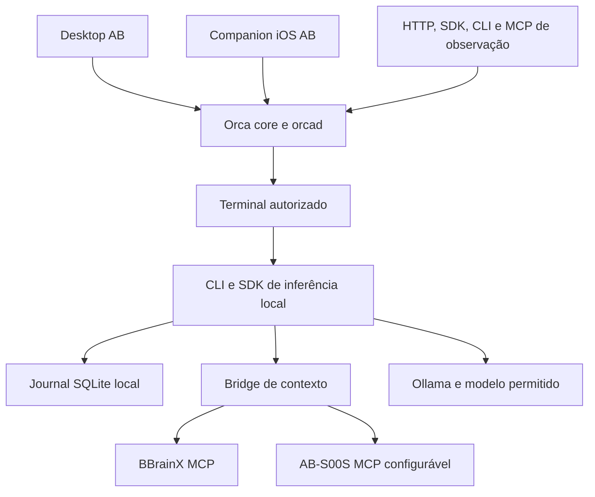

# Continuação P1–P5: implementação, evidência e limites

Este documento acompanha o código AB posterior à entrega P0. A base do fork e as fontes da investigação continuam em [VERIFICATION.md](VERIFICATION.md). Os mapas e recibos P0 descrevem o commit auditado; não são apresentados como análise automática dos módulos adicionados depois.

## Critério de conclusão

Código presente, compilação concluída, ensaio funcional e homologação no ambiente de destino são fatos diferentes. Cada distribuição precisa de um recibo que identifique commit, comando, resultado e limites. Um workflow adicionado ao repositório não prova execução. Um arquivo Xcode sem assinatura não é um IPA instalável. Um endpoint loopback não prova ausência de acesso à internet.

| Frente              | Implementação e evidência local                                                                                                                                                   | Gate adicional                                                                                                             |
| ------------------- | --------------------------------------------------------------------------------------------------------------------------------------------------------------------------------- | -------------------------------------------------------------------------------------------------------------------------- |
| P1 — host AB        | Identidade, perfil e canal de atualização próprios; build real; instalação consentida dos dois plugins; workers reais; ciclo do toggle na interface via CDP.                      | Empacotamento nativo em ambiente com as dependências oficiais; o resultado de CI deve ser registrado pelo commit ensaiado. |
| P2 — contexto       | Bridge SDK/CLI com binding explícito e proveniência; integração real com BBrainX 2.4.0 no commit `7943b40167ea58fa64e208281eb6b95a26da6663`; recusas de escopo e índice obsoleto. | Instalação e homologação do adaptador AB-S00S na infraestrutura autorizada.                                                |
| P3 — persistência   | `orcad` real; pareamento, PTY, reconexão, revogação, limites de concorrência e superfícies HTTP/SDK/CLI/MCP ensaiados.                                                            | Repetir no contêiner e no ambiente de implantação; distinguir clientes conectados de colaboração simultânea em edição.     |
| P4 — execução local | Runtime SQLite durável, política explícita de modelo, contexto BBrainX e inferência Ollama real. Recuperação de processo testada.                                                 | Jornada completa em processo isolado com saída de rede bloqueada; avaliação factual da resposta registrada separadamente.  |
| P5 — distribuição   | Receita Docker, release por manifesto, slots e rollback testados com processos reais; fluxo iOS de preflight, archive, exportação, verificação e instalação.                      | Construir/bootar a ISO, finalizar os artefatos e homologar assinatura/instalação no dispositivo físico.                    |

Os resultados de CI e suas URLs são acrescentados à evidência da entrega após as execuções. Nenhum gate externo é convertido em sucesso por ausência de acesso ao ambiente.

### Primeira evidência nativa iOS

O candidato iOS `3424197f79b49dc2e0f2e018ea33144987178116` passou no [run 41537718266](https://github.com/oalexandrebelo/ab-brainmaster-orca/actions/runs/41537718266): guards de assinatura, 25 testes de push/protocolo e archive Release arm64 com JavaScript embarcado. O artefato ZIP tem SHA-256 `2717258d8f957378e4ae4a655eb89ec39aa23dd764a7ac1f2252a5321536402e`. Ele contém um `.xcarchive` sem assinatura, não um IPA instalável. As alterações posteriores nos diagnósticos exigem nova compilação do commit integrado; esse primeiro run não é usado como prova dos bytes posteriores.

## Topologia implementada



O core de execução e o protocolo de pareamento são reutilizados. A camada HTTP AB expõe sete operações delimitadas de observação; ela não é uma API genérica de RPC ou execução de shell. A execução local usa seu próprio SDK/CLI e pode ser iniciada por um terminal autorizado do Orca. O bridge não concede ao modelo ferramentas de escrita, recrutamento ou administração.

### Host e plugins

A versão efetiva da API de plugins é calculada por `pluginHostVersion(appVersion)`. Ela não pode ser inferida apenas do `package.json`. Os pisos dos manifestos foram preservados e verificados contra a função usada pela inicialização real.

A distribuição AB mantém uma identidade de aplicativo e um perfil próprios. O updater oficial e a telemetria PostHog ficam desativados nessa variante; o alvo upstream conserva seu comportamento. Isso evita que o fork substitua a instalação oficial ou baixe uma atualização de outro produto.

O suporte AB mantém relatos e detalhes de falhas locais, com cópia explícita. A função de transporte recusa uploads upstream e o resolver de diagnóstico ignora inclusive um endpoint herdado por variável de ambiente. O diálogo AB não consulta a identidade GitHub. Integrações cloud opcionais herdadas do Orca continuam separadas: sua existência não obriga a utilizá-las, mas tampouco demonstra bloqueio de toda saída de rede do IDE.

Os plugins executam código Node no host e exigem fonte conhecida, aprovação e fingerprint. A aprovação do manifesto não é uma sandbox de segurança. O painel de revisão upstream somente consulta e classifica mudanças; não faz merge, cherry-pick ou atualização automática. A falha de rede é apresentada como falha, sem fabricar uma lista de resultados.

Billion Context permanece opcional e inicialmente desligado. A integração atual aceita novos terminais Claude com API key em workspaces de pasta locais. Seu sidecar possui ownership, healthcheck e encerramento verificado. Desligar o toggle não mata sessões do usuário que já estão ativas. Não se declara suporte a OAuth, worktrees Git, Windows, SSH/WSL, retomada ou native chat por extrapolação desse ensaio. A opção não aumenta a janela nativa de atenção de um modelo para um bilhão de tokens.

Detalhes e provas: [P1_HOST.md](P1_HOST.md) e [módulo de contexto opcional](../../packages/ab-bill-context/README.md).

### Contexto com escopo e proveniência

O bridge vincula cada conexão a workspace, host, projeto e raiz esperada. A resposta inclui identidade da origem, hashes, caminhos e intervalos inclusivos de linhas. Conteúdo de repositório e respostas de ferramentas são tratados como dados não confiáveis para o modelo. Um índice obsoleto é recusado; atualização do índice exige a operação autorizada fora da recuperação de contexto.

O ensaio BBrainX usa uma fonte pública MIT identificada por commit. O adaptador AB-S00S utiliza o contrato de conexão configurado e não redistribui o projeto privado. Um contrato implementado não demonstra que o serviço remoto foi instalado ou homologado.

O orçamento `o200k_base` do pacote de contexto serve ao empacotamento desse contexto. Não representa a contagem real de tokens de Qwen ou de outro modelo. O runtime local aplica uma política adicional ao envelope completo e registra as contagens retornadas pelo provedor. Proveniência de contexto não equivale a uma snapshot transacional de todos os arquivos.

Detalhes: [CONTEXT_INTEGRATION.md](CONTEXT_INTEGRATION.md).

### Servidor e superfícies de controle

O cliente de controle reutiliza o adaptador runtime do Orca e exige pareamento real. As operações são `status`, `repos`, `workspaces`, `folders`, `terminals`, `terminal_read` e `terminal_wait`. HTTP, SDK, CLI e MCP obedecem ao mesmo contrato. A API exige credencial em arquivo, valida Host/Origin, limita corpo, resposta, concorrência e prazo, e não aceita chamadas arbitrárias do protocolo interno.

O limite de concorrência continua ocupado enquanto uma observação admitida ainda está ativa, mesmo que o cliente abandone sua conexão. Rotação da credencial e revogação de grants foram exercitadas separadamente. A exposição de rede e as permissões do projeto são decisões de implantação; o default do contêiner publica portas apenas no loopback do host.

Persistência de identidade, workspace e histórico após reinício foi ensaiada. Isso não afirma colaboração irrestrita entre tenants, editor CRDT, isolamento por container por agente ou compatibilidade com migrações de banco ainda não testadas.

### Modelo local e recuperação

O runtime local admite uma tarefa por vez e registra a tarefa antes da execução. Chaves de idempotência impedem reenvio acidental de uma mesma solicitação sob configuração diferente. Cancelamento, prazo excedido, falha e interrupção são estados explícitos. Após morte comprovada de um proprietário local, tarefas inacabadas passam a `interrupted`; não há repetição automática de efeitos desconhecidos.

O provedor aceita apenas endpoint numérico loopback, modelo permitido com digest e limites explícitos. Não há fallback automático para nuvem nem download automático de modelo. O journal exige armazenamento local: não é um lock distribuído para NFS ou coordenação entre máquinas.

O ensaio factual deve conservar tanto respostas corretas quanto parciais. Uma tarefa concluída no journal comprova conclusão do pipeline, não correção semântica da resposta. Modelos pequenos usados no teste de transporte não são recomendados automaticamente para decisões de engenharia ou alteração autônoma de código.

Detalhes, configuração e prova com bloqueio de rede: [LOCAL_RUNTIME.md](LOCAL_RUNTIME.md).

## Instalação a partir das fontes

Use Node 24.22.1 e pnpm 12.14.0 para reproduzir os comandos desta entrega. As dependências dos pacotes AB separados têm shrinkwrap próprio; instalar o workspace raiz não substitui essa etapa.

```bash
pnpm install --frozen-lockfile
pnpm run build:packages
npm ci --prefix packages/ab-context-bridge --ignore-scripts --omit=optional --no-audit --no-fund
npm ci --prefix packages/ab-control --ignore-scripts --omit=optional --no-audit --no-fund
pnpm run ab:build:control
pnpm run ab:build:local
pnpm run ab:control help
pnpm run ab:context --help
pnpm run ab:local --help
pnpm run ab:ios --help
```

`ab:build:host` constrói a variante desktop. `ab:pack:host` inclui os gates oficiais de empacotamento; não substitua helpers nativos por arquivos vazios ou stamps artificiais. Os READMEs de cada módulo documentam suas dependências de ensaio e suas plataformas verificadas.

## Atualização e rollback

A revisão do upstream e a ativação de um release são operações distintas. O release é verificado por manifesto antes de ser copiado para um slot. A ativação troca o ponteiro de forma atômica e recusa um serviço ainda em execução. O perfil fica fora do diretório de código.

O teste local usou dois identificadores de release sobre o mesmo build do core e comprovou staging, ativação, reinício, persistência, rollback e recusa de conteúdo adulterado. Isso não prova reversibilidade de migrações entre duas versões futuras distintas do banco. Antes de uma atualização que altere o formato persistido, backup e restauração devem ser validados para esse par de versões.

A exclusão mútua de staging/ativação usa uma transação SQLite dedicada, sem tabelas de domínio. O ensaio inclui morte por SIGKILL durante staging e operações concorrentes após a liberação do lock pelo sistema operacional. Isso elimina o lock de arquivo irrecuperável encontrado na revisão.

Fixar a base de imagem por digest e verificar payloads reduz variabilidade dos insumos. Uma receita repetível não implica igualdade bit a bit de todos os artefatos, sobretudo quando pacotes do sistema operacional ainda são resolvidos em um repositório móvel.

## iPhone 13 Pro e IPA

O cliente é um companion do host AB. O processamento de agentes continua no host; o aplicativo iOS não transforma o iPhone em um servidor `orcad` permanente. A variante AB tem bundle ID, URL scheme, nome e atualização manual próprios. Push remoto começa desativado. Diagnósticos ficam disponíveis para cópia local; o envio ao suporte upstream é bloqueado também na função de transporte.

O fluxo de distribuição verifica a assinatura existente, o perfil, a inclusão do aparelho, o executável arm64, o JavaScript Release e os entitlements. Um archive unsigned é uma evidência de compilação, sem autorização de execução no aparelho. Exportação assinada, instalação e ensaio físico são gates separados.

`ipatool` foi utilizado dentro de sua função real: consultar a ferramenta oficial de download de pacotes App Store. Ele não compila, assina ou instala este fork. A geração do IPA próprio usa Xcode e a instalação usa as ferramentas Apple para o aparelho autorizado.

Procedimento completo, pré-requisitos e limites: [IOS_DISTRIBUTION.md](IOS_DISTRIBUTION.md).
